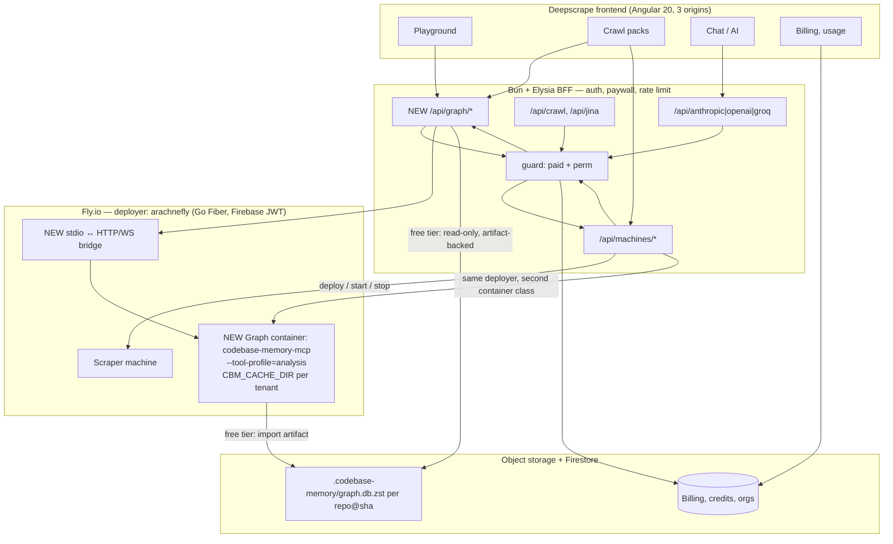

# ADR-2026-09-MCP-SERVICE-EXPOSURE: exposing the code graph, Arachnefly and the crawler as services

- **Status:** proposed (needs a decision from the product owner on the tier split)
- **Date:** 2026-09-30
- **Scope:** `deepscrape/deepscrape` (Angular app + Bun/Elysia BFF), `deepscrape/arachnefly`
  (Go Fiber machine deployer), `DeusData/codebase-memory-mcp` (C, stdio MCP server)

## Context

Today the platform already exposes two sibling projects as guarded services, and it does so the
same way twice: the browser calls the deepscrape **BFF**, and the BFF holds the credentials and the
paywall.

| Consumer (Angular) | BFF route | Backing service | Guard |
|---|---|---|---|
| Playground, crawl packs | `POST /api/crawl`, `GET /api/jina/:url` | Crawl4AI | `guard([…])` |
| Chat / AI surfaces | `POST /api/anthropic/messages`, `/api/openai/chat/completions`, `/api/groq/…` | LLM providers | `guard([…])` |
| Machines, crawl packs | `POST /api/machines/deploy`, `GET /api/machines/check-image`, `…/waitforstate/:id` | **arachnefly** | `guard([paid, perm('machine','read'), …])` |

So Arachnefly is **already** wired behind the paywall — `paid` plus a `machine` permission — and it
already authenticates with Firebase JWTs of its own. The gap is not authentication on Arachnefly.
The gap is that the **code graph is not a service at all**: it runs only inside a developer's editor
on their own machine.

### The constraint that decides the design

`codebase-memory-mcp` is not a server we can simply put behind nginx. From its own documentation:

- **stdio transport only.** The only HTTP surface is the graph-visualisation UI on `:9749`, owned by
  the coordination daemon so concurrent sessions don't start duplicate servers.
- **One account, one build, one cache root.** "All active CBM processes must run the exact same
  version, executable build, coordination ABI, and canonical cache root" — a different root is
  *rejected while any CBM process is active*, enforced by a crash-safe OS admission barrier.
- **Local by design.** "All processing happens 100% locally; your code never leaves your machine" and
  "cbm makes no network request of its own accord".
- **It has a sanctioned sharing mechanism:** `.codebase-memory/graph.db.zst`, an integrity-checked,
  zstd-compressed SQLite snapshot with two tiers (Best: `zstd -9`, index-stripped, `VACUUM INTO`;
  Fast: `zstd -3`). A clone that finds the artifact imports it and then only indexes the diff.

Multi-tenancy therefore cannot be achieved by running one daemon for many users, and a naive
"one container per request" fights the admission barrier. The design has to pick one of three
shapes per tier.

## Decision (proposed)

**Ship the artifact first, containers second, fork last.**

1. **Free tier — published graph artifacts.** Index projects centrally (nightly, or on push) and
   publish `graph.db.zst` + `artifact.json` to object storage (R2/S3) keyed by `owner/repo@sha`. The
   user's own local install imports it and incrementally indexes their diff. Zero multi-tenancy, zero
   transport work, uses the upstream contract, and costs storage instead of compute.
2. **Paid tier — one container per tenant, one cache root each.** The container runs the binary with
   `--tool-profile=analysis`, a tenant-scoped `CBM_CACHE_DIR`, and no ambient FS. Because the
   isolation boundary is the container filesystem, the "one canonical cache root" invariant is
   satisfied *per tenant*, not violated. The MCP client reaches it through a thin **HTTP/WS →
   stdio bridge** (the community `shrinedogg/codebase-memory-mcp-container` already does the
   containerisation half), authenticated with the same Firebase JWT Arachnefly already accepts.
3. **Do not fork the engine.** A genuine multi-tenant daemon means HTTP/SSE transport, per-tenant
   caches and an auth layer *inside* a pure-C codebase with an admission barrier whose whole job is
   to assume one account. That is a rewrite with an upstream-merge tax, and it is the only option
   that leaks other tenants' code into a shared SQLite store. Revisit only if (1) and (2) are
   outgrown.

### Arachnefly is the container runtime for both tiers

Arachnefly is already a generic Fly.io machine deployer (`POST /deploy`, `PUT /machine/:id/start`,
`POST /execute-task/:id`) with Firebase JWT auth and metric-driven autoscaling. The graph containers
are just a **second container class** on the machine the scraper machines already run on — same
deployer, same auth, same autoscaler, no second control plane.

## Phased rollout

| Phase | Deliverable | Gate |
|---|---|---|
| 0 | Index the deepscrape repo centrally; publish `graph.db.zst` to R2 on push to `main` | artifact exists and imports cleanly on a clean checkout |
| 1 | `bff/graph.ts` + `/api/graph/*`: list projects, query, trace, coverage — proxying a **local** install over the bridge; `guard([paid, perm('graph','read')])` | a paid user queries the graph from the Angular app |
| 2 | Graph container class deployed through Arachnefly; per-tenant `CBM_CACHE_DIR`; bridge auth via Firebase JWT | two tenants cannot see each other's graphs |
| 3 | Free tier: artifact download + import in the app; `--tool-profile=scout` parity (narrow surface, no exhaustive claims) | free user gets graph answers without any hosted compute |
| 4 | Usage metering into the credit ledger; graph queries debited like crawl credits | billing reconciles with actual container minutes |

## Risks and things to verify early

- **Artifact churn is a real, documented footgun.** The reference implementation warns one team
  reached ~6 GB of history from ~350 commits of that single path. Publish per release/milestone, or
  use LFS — never per save.
- **The bridge is the new attack surface.** It accepts a JWT and drives a privileged local process
  that reads arbitrary paths via `allow-root`. It must pin the allow-root per tenant and reject
  anything else, or a tenant reads the host.
- **`--tool-profile=scout` semantics matter for the free tier**: it is defined as ~3–4 narrow calls
  with *no* absence, exhaustive-impact, or dead-code claims. Selling that as "full analysis" would be
  false advertising.
- **Arachnefly is on Go Fiber and Firebase JWT** — the same auth the BFF already trusts, so no new
  identity system is needed; but its endpoints must stay behind the BFF, never be called from the
  browser directly.

## Open questions (Copilot questions)

1. Is the free-tier offer **artifact download** (static, cheap) or **hosted queries** (compute per
   user)? Everything about cost and abuse depends on this.
2. Do we index **only deepscrape-owned repos**, or arbitrary user repos? The latter needs a queue, a
   storage budget, and a malware/abuse story.
3. Which BFF permission gates the graph — reuse `perm('machine','read')`, or a new `graph` resource
   in `authz.domain.ts`?
4. Do graph queries spend **credits** (like crawl credits) or fall under the plan cap
   (`usageCap` already exists in `getBillingUsage`)?
5. Is per-tenant isolation **container-per-user** or **container-per-crawl-pack**? The crawl pack is
   already the natural project boundary in the UI.
6. Who owns the bridge — a new Go service beside Arachnefly, or an Elysia route in the BFF? Go puts it
   next to Arachnefly's machine lifecycle; Bun keeps it in one deployable.
7. Upstream posture: do we contribute the containerisation upstream, or vendor the fork and carry the
   merge? The engine is MIT and actively released.
8. Does the answer to question 1 change if `codebase-memory-mcp` adds an HTTP transport upstream?
   (Watch its releases; a real transport removes phase 2's bridge entirely.)

## Tasks (Copilot tasks)

- [ ] `docs/`: verify phase 0 by publishing one artifact and importing it on a clean clone.
- [ ] `bff/graph.ts` + `/api/graph/*` routes, following the `bff/api.ts` + `guard(...)` + `bind(...)`
      pattern used by `machines` — no new pattern.
- [ ] Add the `graph` resource to `functions/src/domain/authz.domain.ts` if question 3 says so.
- [ ] Arachnefly: a second machine class (graph container) behind the existing
      `POST /deploy` + `execute-task` endpoints; document the cache-root-per-tenant rule.
- [ ] Angular: a Graph surface in the playground (or a new tab in crawl packs) that calls
      `/api/graph/*`; reuse the existing crawl-pack project selector as the tenant key.
- [ ] Meter graph usage into the credit ledger with the same idempotency-key discipline as
      `applyBillingCreditMutation`.
- [ ] Reconcile this ADR with `docs/ADR-2026-09-PLATFORM-ARCHITECTURE.md` decision 3 (Stripe owns
      payment data; Firestore mirrors presentation) — the same "don't mirror what you can fetch" rule
      applies to graph artifacts: publish them, don't duplicate them.

## Recommendation (2026-10-10) — measured audit, then revised against upstream v0.11.0

**Measured state: 0 of the 7 tasks above are done; 0 of the 5 phases are implemented.** The full
per-layer table, with provenance for every row, is
`docs/roadmap/12-service-orchestration-and-layer-inventory.md` §9. The only thing that exists is the
prerequisite — local artifact generation.

Then the README and release notes of `DeusData/codebase-memory-mcp` were read. Three findings change
this ADR, and two of them make the work **smaller**.

### 1. Do NOT build the stdio↔HTTP bridge. Upstream removed the need for it.

**Question 8 is answered: no transport arrived.** The architecture section is still
`main.c — MCP stdio server + CLI + install/update/config`; the only HTTP port is the graph UI on
`:9749`, owned by the daemon. So the hopeful branch ("a real transport removes phase 2's bridge") is
closed.

The bridge is unnecessary anyway, for two upstream reasons:

- **Every MCP tool is also a one-shot CLI** — `codebase-memory-mcp cli <tool> --format json`, e.g.
  `cli search_graph --project p --name-pattern '.*Handler.*' --format json`. That is a process exec
  and a JSON reply: no JSON-RPC framing, no stdio protocol, no bridge to write or carry.
- **`CBM_ALLOWED_ROOT` is upstream's own multi-tenant control**, documented verbatim as *"Useful when
  the server may be driven by an untrusted caller, e.g. agentic or multi-tenant deployments"*. It
  confines `index_repository` to a directory, resolving symlinks and `..` before deciding. And
  `--tool-profile` uses **positive allowlists** (Scout 7 tools, Analysis 11), with future or mutating
  tools unavailable until explicitly reviewed.

So phase 2 becomes: **a per-tenant container in which the caller execs `cbm cli <tool> --format json`
with `CBM_ALLOWED_ROOT` pinned to that tenant's checkout.** Smaller than writing a bridge, and
*sаfer*, because the confinement is upstream-enforced rather than our own path parsing. It also
retires this ADR's own "the bridge is the new attack surface" risk: the surface is now a subprocess
with a documented confinement variable.

### 2. Publish to the EXISTING Tigris store. Not R2, and not git.

- **R2 does not exist in this repo.** Verified: `R2_*`, `CLOUDFLARE_R2`, `r2.dev` return **0 hits**.
  The platform already has an object store — Tigris/S3 via `s3-blob-store.ts`. So the "publish to R2"
  wording throughout this ADR is aspirational, and phase 0 is blocked on this decision alone.
- **Do not commit the artifact, and do not reach for LFS.** Upstream's own LFS guidance names the
  costs: GitHub meters LFS storage and bandwidth, LFS objects cannot be pruned without contacting
  support, every teammate needs `git lfs install`, without which their checkout leaves a pointer file
  where the artifact should be and the integrity-checked import refuses it, silently falling back to a
  full reindex. A repo that already has the blobs needs `git-filter-repo` first. And the artifact is
  rewritten on **every** index *including the watcher's Fast tier*, which is exactly how upstream's own
  ~6 GB / ~350-commit warning arises.
- Upstream explicitly blesses the alternative: *"Add `.codebase-memory/` to `.gitignore` if you prefer
  everyone to reindex from scratch."* This repo already does that, so the audit's "`.gitattributes`
  contradicts `.gitignore`" finding is a **settled decision, not a defect** — the ignored
  `.gitattributes` is simply inert.
- Publish out-of-band instead; `POST /api/storage/presign` already mints a scoped, time-limited URL.

### 3. The `compression_level: 3` artifact is CORRECT, not a defect

Upstream defines two tiers: **Best** (`zstd -9` + index strip + `VACUUM INTO`), written *only* by
`index_repository` with `persistence: true`; and **Fast** (`zstd -3`), which *refreshes an existing
artifact on every other index, including the watcher's low-latency incremental updates*. Our artifact
reports `compression_level: 3` — precisely the watcher refresh. Nothing is broken. The consequence is
narrow but real: the publish step must **trigger a Best export** rather than snapshot whatever the
watcher last left.

### 4. Question 3 still gates phase 1, and it is the cheapest thing left to decide

Recommendation: **add a `graph` resource to `AuthResources`** rather than reusing
`perm('machine','read')`. `machine.read` is tenant-scoped but held by *every* paid user, and the
graph's cost driver is compute rather than machine count — so reusing it means graph access can never
be sold, capped, or priced separately without an authz change. The edit is roughly six lines
(`authz.domain.ts` type + `POLICIES`). **Raised rather than taken, because it changes authorization.**

### 5. Correct the free-tier pitch

This ADR calls `--tool-profile=scout` "~3–4 narrow calls". Upstream says Scout exposes **7** tools and
Analysis **11**, both positive allowlists. The qualitative limit this ADR warns about is real and can
now be quoted exactly: Scout has *"no absence, exhaustive-impact, or dead-code claims"*. Do not sell it
as full analysis.

