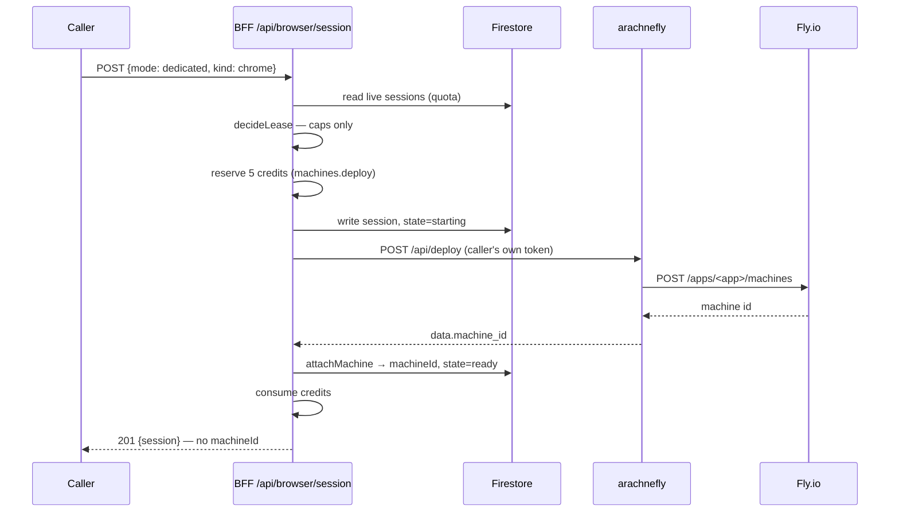

# What a browser session IS (and what it is not)

Written 2026-10-02, because the model had never been stated in one place and that made the role of
`/api/browser/session*` genuinely hard to see. If you are reading this to understand the platform, read it
before the roadmap — the roadmap is a sequence, not a concept.

---

## The one-sentence answer

**A browser session is a lease on one exclusive, stateful browser that belongs to one tenant — and it is
not a scraper.**

It exists for the things the scraping engine cannot do: a real browser that survives between requests, can
be driven interactively, and can produce a trustworthy screenshot.

## The model, correctly — and a correction to an earlier version of this page

An earlier version of this file said a dedicated session's machine "does not run webrain". **That was
wrong.** Roadmap `06-browser-sourcing-options.md` is authoritative, and it reframes browser sourcing as
**two axes, not three options** — the first of which is literally *"where webrain runs"*.

| Axis | Question | Options |
|---|---|---|
| **A1 — where webrain runs** | whose process drives the browser? | shared process ✗ · pool of exclusive workers ✓ · dedicated machine ✓ |
| **A2 — where the browser comes from** | which engine, from where? | bundled in the worker · a platform browser pool · the caller's own CDP URL |

A **browser session is a lease on one webrain worker**, and the browser is bundled *inside* that worker. So
`BROWSER_MACHINE_IMAGE` is not really "a browser image" — it is the **worker image, which must carry a
rendering browser**. That is a naming problem rather than a design one (the variable is server-side only),
but it is the name that misled this page.

The real distinction is therefore **not** "webrain or not". Both tiers are webrain:

| | plain scraping (`/api/crawl`) | a browser session |
|---|---|---|
| webrain | a **shared** process, stateless tools only | a worker **of your own** |
| state | none — one call in, one result out | survives between calls |
| browser | usually none at all (`fetch_http`) | **bundled and rendering**, one per session |
| chosen by | `SCRAPE_PROVIDER` | `mode: "dedicated"` + `kind` |
| cost to us | shared, near-zero | a whole worker |

What you buy with a session is the thing the stateless path cannot give: a real browser profile,
interactive challenges, authenticated pages, and frames. `kind` (`chrome` / `lightpanda` / `obscura`)
selects which engine that worker launches — and lightpanda is 123 MB and fast with **no graphical
rendering**, which is exactly why it is attractive for volume and useless for live view.

The skill's engine rule follows from that: **never** route a frame request to Lightpanda, because its
screenshot is a *fake placeholder PNG* — not an error, a plausible wrong image. Gate it in code, not in UI
copy.

## Why exclusivity is the whole point

Invariant **I2**: *no shared-process browser*. A browser reachable through a process anyone else can reach
is a cross-tenant leak, whatever the pooling is called. So one session owns one browser, exclusively, and
if you cannot name the single tenant who owns a worker, you do not launch a browser in it.

That is why the session carries a **cap** (`SESSION_CAPS`) rather than a queue: the scarce thing is the
exclusive machine, and the cap is what keeps the platform from absorbing unbounded cost.

## The two modes

| `mode` | Who provides the browser | Machine | Charged |
|---|---|---|---|
| `dedicated` | **we** provision a Fly machine | one per session, named `bs-<sessionId>` | 5 credits, at the `machines.deploy` action |
| `byo` | the caller brings a CDP endpoint (`cdp_url`) | none of ours | nothing — they already pay their own provider |

`free` cannot have either (both caps are 0), and `decideLease` refuses before anything is provisioned.
`byo` stores the endpoint in Google Secret Manager under a **per-user** name, never in the session
document, and never returns it.

## Answering the questions that keep coming up

### Can one machine host several sessions — several browsers?

**Today: no, and by cap.** `SESSION_CAPS.paid.dedicated` is 1, so a paid caller holds one dedicated session
at a time, and free holds none.

**In principle: only within one tenant — never across tenants.** Invariant **I2** is the boundary: a browser
reachable through a process anyone else can reach is a cross-tenant leak, whatever the pooling is called.
Three verified properties of a *shared webrain process* make cross-tenant impossible:

1. session routing takes the caller's `session_id` verbatim (`webrain/lib.rs:1236`);
2. `webrain_session(op=list)` enumerates **every** session plus its `cdp_url` (`lib.rs:1276-1288`);
3. there is one process-wide secret, no caller identity, and `SessionMeta` carries no uid.

The sentence to remember: **the insecure unit is the webrain *process*, not the browser.** More browsers
behind one webrain does not help — tenant A can still name tenant B's `session_id` and drive their browser,
cookies and all. So it is one webrain process per tenant. Several browsers *inside* one tenant's worker is
a later question and not a safety problem.

### Then how does a *free* user get a browser in the playground?

**They don't — and that is deliberate.** The free tier is HTTP-only:

- `SESSION_CAPS.free` is 0 across the board, so a free caller gets no session at all.
- The shared webrain runs with **`WEBRAIN_NO_STATE=1`**, which *refuses* `webrain_launch` (it is in
  `STATEFUL_TOOLS`). A shared worker **physically cannot start a browser** — a config flag, not a policy
  hope. That is exactly what makes "shared" safe.
- `fallback_chain` tries the HTTP engines first and reaches for a browser only if one is available, so the
  free path is real and fast (10-100x cheaper) rather than broken.

So a JS-heavy page in the free playground fails **by design** today. The answer is not a shared browser —
that row is unusable for every browser source — it is an **exclusive worker pool**: a machine leased
exclusively to one tenant for one session, then recycled. That is a **capacity purchase**, and roadmap `06`
recommendation 8 says to build it when JS-dependent free calls *measurably* fail, with `07` Part H covering
the budget.

### Where does webrain actually get deployed?

Three shapes, matching the two axes:

| Tier | webrain runs as | Browser | Reached by |
|---|---|---|---|
| free | one **shared** process, `WEBRAIN_NO_STATE=1` | none — the launch is refused | `WEBRAIN_MCP_URL` |
| paid (dedicated) | **inside the session's Fly machine** | bundled, rendering | arachnefly `GET /machine/proxy/:id` (internal port `11235`) |
| later | a pool of **exclusive workers** behind **our** router | bundled | our gateway — `uid → worker` is ours |

That is why `WEBRAIN_MCP_URL` has **no default**: for the dedicated tier the worker is per-machine, so one
global URL cannot be right for both. Today the variable points at the shared worker and nothing establishes
a per-machine worker URL — the second half of why a dedicated session cannot be driven yet.

## What actually happens on `POST /api/browser/session` (`dedicated`)



The record is written **before** the machine is asked for. The other order orphans a VM on a mid-flight
failure. The machine is named from the session id, so Fly's own unique-name rule is the idempotency key.

## The lifecycle as actually built

```
starting ──► ready ──► closed
                └────► (never reached: "suspended")
```

- **`starting`** — written, machine being created.
- **`ready`** — a machine id is attached. Means *has a machine*, not *accepting connections*: nothing calls
  arachnefly's `waitforstate`.
- **`closed`** — terminal. Written by the caller's close, and by the reaper when an idle session expires.
- **`suspended` is declared in both repos and written by NEITHER.** Verified 2026-10-02: the only
  occurrences are the two declarations and a reaper test. The reaper *suspends the machine* and then marks
  the **session** `closed`, because an expired lease is over. So `suspended` is dead vocabulary — do not
  build on it without also building a resume path, since nothing can start a suspended machine.

Closing a session **releases its machine** (suspend), because the reaper skips `closed` sessions by design
— so the close path is the only thing that can free it. A failed release deliberately leaves the session
OPEN so the reaper remains the backstop.

## Why the role is invisible today — the missing join

**A session cannot currently be used, and the reason is structural rather than an oversight.**

1. `machineId` is deliberately **absent from `BrowserSessionPublic`** — so no response tells a caller which
   machine their session owns. That is a security property, not an accident: the Fly machine id is internal.
2. The only machine-addressed route the platform exposes is
   `POST /api/machines/execute-task/:machineId` — and it does **not** drive a browser (see below), so it is
   not a browser command channel at all.

⇒ **The two halves cannot be connected.** A browser-session client has no way to name the machine, and
nothing that reaches a machine does browser work. So today a session is a **lease on a billable machine that
nothing can drive**.

Also missing, for the same reason:

- **No endpoint.** arachnefly has `GET /api/machine/proxy/:id`, but `handlers/machines.ts` has **no method
  for it at all** — so the proxy route is unreachable from the platform. Nothing returns a CDP or WebSocket
  URL, and `cdp` appears nowhere in `functions/src/**`.
- **No live view, no frames.**
- **No per-minute metering (§1.6).** Once the 5-credit deploy is paid, the machine's running time costs the
  customer nothing — on platform compute. That is the remaining revenue gap.

### Why `execute-task` is NOT the answer — a correction to an earlier version of this page

`POST /api/machines/execute-task/:machineId` looked like the obvious missing link. It is **not one**, and
an earlier version of this page recommended building on it. Reading what arachnefly's `ExecuteTask`
actually does: it relays the caller's JSON to a **hard-coded** URL — `https://<FLY_APP>.fly.dev/crawl` —
pinning it to one machine with Fly's `fly-replay: instance=<id>` header.

So it drives the **crawl4ai `/crawl` contract**. Not webrain's MCP surface, and not CDP. Wiring a
session-scoped execute route through it would have shipped a route that names a machine and drives the
**wrong service** — worse than the honest gap it was meant to close.

(It also asked Fly for a list of every started machine on each call, purely to log it. That list is gone:
it made a working call fail when the list failed, and it spent an app-scoped Fly API request competing with
`Create Machine` for the same 1 req/s bucket.)

### So what IS the missing link

Roadmap `06` already names it for the paid tier: *"Paid → dedicated machine … Reached via arachnefly
`GET /machine/proxy/:id`"*. And `handlers/machines.ts` has **no method for that proxy route at all**, so it
is unreachable from the platform today.

The join is therefore one of:

- **a per-machine worker URL** — webrain's MCP surface on the session's own machine. This is why
  `WEBRAIN_MCP_URL` has no default: one global URL cannot serve the dedicated tier, and nothing currently
  derives a per-machine one.
- **the container proxy** — expose `GET /api/machine/proxy/:id` and let the session address it.

Both decide **the shape of access** — direct from the browser, through the BFF, or via the live-view host —
which is why this is a deliberate decision rather than the first thing that compiles. Roadmap `03`
(live view and UI) is where it belongs.
